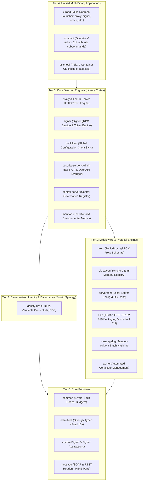

# X-Road (Rust Port)

[](https://github.com/wearesovrin/x-road/actions/workflows/ci.yml)
[](https://doc.rust-lang.org/edition-guide/rust-2024/index.html)
[](LICENSE)
[](https://sovrin.ee)

An idiomatic, modular, high-performance, and memory-safe **Rust port** of the **X-Road** data exchange layer.

X-Road is the open-source data exchange layer that powers national digital ecosystems (such as Estonia's X-tee and Finland's Suomi.fi-palveluväylä). This implementation is maintained by **Sovrin OÜ** (`info@sovrin.ee`) under `github.com/wearesovrin/x-road` and incorporates native integration with **Sovrin Decentralized Identity (DID/VC)** and modern European Data Spaces architectures.

---

## Architecture Overview

The workspace organizes X-Road into a 5-tier multi-crate Cargo workspace, decoupling core data types from protocol parsers, cryptography engines, storage adapters, and daemon entrypoints:



---

## Workspace Crates Explanation

The workspace consists of **18 modular member crates** located under `crates/`:

| Crate | Tier | Upstream Java Counterpart (`java/src/...`) | Explanation & Responsibilities |
|---|---|---|---|
| [`common`](crates/common) | 0 | `common:common-core` | Core primitives, unified error types (`XRoadError` via `thiserror`), standard fault codes (`FaultCode`), and request deadline propagation (`CallBudget`). |
| [`identifiers`](crates/identifiers) | 0 | `common:common-db-identifiers` | Strongly-typed X-Road identifiers (`ClientId`, `ServiceId`, `SecurityServerId`, `GlobalGroupId`) with strict specification parsing and display. |
| [`crypto`](crates/crypto) | 0 | `common:common-core/.../crypto` | Cryptographic hashing primitives (SHA-256, SHA-512), asynchronous `Signer` trait, and PKI validation interfaces. |
| [`message`](crates/message) | 0 | `common:common-message` | Ingestion, validation, and serialization of X-Road HTTP/REST headers (`x-road-client`, `x-road-service`, etc.), SOAP envelopes, and MIME multipart descriptors. |
| [`proto`](crates/proto) | 1 | `lib:rpc-core`, proto schemas | Unified Protocol Buffer compilation via `tonic-build` providing gRPC client and server stubs for all 10 X-Road internal services under `package xroad`. |
| [`globalconf`](crates/globalconf) | 1 | `lib:globalconf-core`, `-impl` | Global configuration anchor parsing (`ConfigurationAnchor`), instance discovery, and thread-safe in-memory cache registry (`GlobalConf`). |
| [`serverconf`](crates/serverconf) | 1 | `lib:serverconf-core`, `-impl` | Local Security Server configuration abstractions (`ServerConfProvider`), access rights evaluation, and database models backed by **SeaORM 2.0** (`sea-orm` & `sea-orm-migration`). |
| [`asic`](crates/asic) | 1 | `lib:asic-core`, `tool:asic-*` | Associated Signature Containers (ASiC-e RFC 3161 / ETSI TS 102 918) packaging, unpacking, and bundled standalone `asic-tool` CLI binary. |
| [`messagelog`](crates/messagelog) | 1 | `lib:messagelog-core` | Tamper-evident transaction logging and Freudenthal batch tree hashing (`BatchHasher`) for computing root verification hashes prior to timestamping. |
| [`acme`](crates/acme) | 1 | `lib:acme-core` | ACME (RFC 8555) automated TLS, authentication, and signing certificate lifecycle management backed by **`instant-acme`** with raw CSR submission and HTTP-01 challenge fulfillment. |
| [`identity`](crates/identity) | 2 | `service:ds-*`, `lib:ds-*` | Sovrin / W3C Decentralized Identifiers (DIDs), Verifiable Credentials (VCs), and `IdentityResolver` trait for European Data Spaces / EDC integration. |
| [`signer`](crates/signer) | 3 | `service:signer` | Signer gRPC service library implementing `KeyService` and `SignService` for software tokens and PKCS#11 hardware security modules (HSM). |
| [`confclient`](crates/confclient) | 3 | `service:configuration-client` | Configuration client library for fetching, verifying digital signatures, and applying signed global configuration files from central servers. |
| [`proxy`](crates/proxy) | 3 | `service:proxy` | High-performance message exchange proxy engine with Poem HTTP routing pipeline, header translation, and access control verification. |
| [`monitor`](crates/monitor) | 3 | `service:monitor`, `op-monitor` | Environmental metrics collector (CPU, memory, disk) and gRPC telemetry service library (`MonitorService`). |
| [`security-server`](crates/security-server) | 3 | `security-server:admin-service` | Security Server Administration REST API engine with Poem and interactive OpenAPI documentation (`poem` + `poem-openapi` with Swagger UI). |
| [`central-server`](crates/central-server) | 3 | `central-server:admin-service` | Central Server administrative and configuration service with Poem and OpenAPI (`poem` + `poem-openapi`). |
| [`x-road`](crates/x-road) | 4 | Root facade & tools | Umbrella facade crate re-exporting all core modules and housing **multiple binaries**: the unified daemon node launcher (`x-road`) and the operator CLI (`xroad-cli`). |

---

## Binaries & Executables

### 1. `x-road` (Unified Multi-Daemon Node Launcher)
Located in `crates/x-road/src/bin/x-road.rs`. Starts individual server daemons or all services in a single process:

```bash
cargo run -p x-road --bin x-road -- --help
```
Commands:
- `proxy`: Start the Security Server Proxy daemon (`--bind 127.0.0.1:8080`, `--client DEV/COM/12345678`)
- `signer`: Start the Signer key management gRPC daemon (`--bind 127.0.0.1:50051`)
- `confclient`: Start the Configuration Client synchronization daemon (`--instance DEV`, `--url http://central-server/internalconf`)
- `monitor`: Start the Environmental Monitoring daemon (`--bind 127.0.0.1:50052`)
- `admin`: Start the Security Server REST administration API (`--bind 127.0.0.1:4000`)
- `central`: Start the Central Server daemon (`--bind 127.0.0.1:8000`, `--instance DEV`)

### 2. `xroad-cli` (Administrative & Operations Tool)
Located in `crates/x-road/src/bin/xroad-cli.rs`. Provides operators with commands to inspect cluster status, manage cryptographic keys, synchronize configuration, and perform ASiC-e operations:

```bash
cargo run -p x-road --bin xroad-cli -- --help
```
Commands:
- `status`: Check operational status of X-Road services
- `key`: Key management operations (`list`, `generate`)
- `conf`: Inspect or trigger configuration updates
- `asic`: Package (`pack`) or inspect (`inspect`) ASiC-e containers

### 3. `asic-tool` (Bundled in `crates/asic`)
Located in `crates/asic/src/bin/asic-tool.rs`:

```bash
cargo run -p asic --bin asic-tool -- --help
```
Commands:
- `pack`: Package message and signature into an `.asice` container
- `inspect`: Display container structure and metadata

---

## Quickstart

### Prerequisites
- **Rust**: 1.85+ (Rust 2024 edition compatible)
- **Protobuf Compiler**: `protoc` (for gRPC code generation)
  - macOS: `brew install protobuf`
  - Ubuntu/Debian: `sudo apt-get install -y protobuf-compiler`

### Build Workspace
```bash
cargo build --workspace
```

### Run Tests
```bash
cargo test --workspace
```

### Check Code Formatting & Lints
```bash
cargo fmt --check
cargo clippy --workspace
```

---

## Docker & Container Registry (GHCR)

The repository provides a multi-stage [Dockerfile](Dockerfile) and GitHub Actions workflow ([.github/workflows/docker.yml](.github/workflows/docker.yml)) that publishes production images to GitHub Container Registry (`ghcr.io`):

| Image | Target | Description |
| :--- | :--- | :--- |
| `ghcr.io/wearesovrin/xroad-security-server` | `security-server` | Security Server daemon with Poem OpenAPI Admin UI & Proxy |
| `ghcr.io/wearesovrin/xroad-central-server` | `central-server` | Central Server configuration & management service |

### Running End-to-End with Docker Compose

A complete end-to-end environment with Central Server, Security Server, and a sample Python adapter service is defined in [docker-compose.yml](docker-compose.yml):

```bash
# Start Central Server, Security Server, and Sample Provider Service
docker compose up -d

# Run the end-to-end verification script
./examples/test-e2e.sh
```

### Building Locally

```bash
# Build Security Server container
docker build --target security-server -t ghcr.io/wearesovrin/xroad-security-server:latest .

# Build Central Server container
docker build --target central-server -t ghcr.io/wearesovrin/xroad-central-server:latest .
```

---

## Sovrin Synergy & Data Spaces

In addition to core X-Road message exchange, this Rust port includes native support for **Sovrin Decentralized Identity**:
- **W3C DIDs & Verifiable Credentials**: Located in [`crates/identity`](crates/identity), allowing organizations to resolve decentralized identifiers and exchange verifiable presentations alongside traditional PKI certificates.
- **Data Spaces Integration**: Aligns with X-Road 7.x dataspace extensions and Eclipse Dataspace Connector (EDC) interoperability protocols.

---

## Trademarks & Attribution

- **NIIS®** is a European Union Trade Mark (no 017625484) registered by the European Union Intellectual Property Office for the **Nordic Institute for Interoperability Solutions (NIIS)**.
- **X-Road®** is a European Union trademark (no 017918049) registered by the European Union Intellectual Property Office for the **Estonian Information System Authority (RIA)** and managed and sub-licensed by **NIIS**.
- For full details, see [TRADEMARK.md](TRADEMARK.md) and the upstream [NIIS Trademark Usage Guidelines](java/TRADEMARK.md) (or [upstream repository](https://github.com/nordic-institute/X-Road/blob/develop/TRADEMARK.md)).

### Original Authors & Copyright Notice

This work builds upon the specifications and open-source architecture developed by the original authors:
- **Copyright (c) 2019- Nordic Institute for Interoperability Solutions (NIIS)**
- **Copyright (c) 2018 Estonian Information System Authority (RIA), Nordic Institute for Interoperability Solutions (NIIS), Population Register Centre (VRK)**
- **Copyright (c) 2015-2017 Estonian Information System Authority (RIA), Population Register Centre (VRK)**
- **Copyright (c) 2026 Sovrin OÜ (`info@sovrin.ee`)** (Rust port and extensions)

---

## Maintainers & License

Maintained by **[Sovrin OÜ](https://sovrin.ee)** (`info@sovrin.ee`).

Licensed under the [MIT License](LICENSE).
